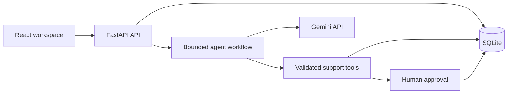

# AI-Powered Customer Support

A customer-support workspace with a React frontend, FastAPI backend, SQLite persistence, and Gemini-powered tool calling.

## Features

- View customers, orders, shipments, returns, and cancellation eligibility
- Ask the support assistant questions about an order
- Propose address updates, returns, and cancellations for explicit approval
- Keep Gemini credentials on the backend only

## Run locally

From the project root:

```powershell
$env:GEMINI_API_KEY = "your-gemini-api-key"
.\.venv\Scripts\python.exe -m uvicorn backend.app.main:app --host 127.0.0.1 --port 8000
```

In a second terminal:

```powershell
cd frontend
npm install
npm run dev
```

Open the URL printed by Vite, usually `http://localhost:5173`.

## Stack

React, Vite, FastAPI, SQLite, Pydantic, and the official Google Gen AI SDK.

## Architecture



The frontend sends customer and order requests to FastAPI. The agent workflow
uses Gemini for tool selection, validates every tool call, reads support data
from SQLite, and pauses write operations until the user explicitly approves
them.

## Policy document

Business rules are centralized in [`config/cancellation_policy.json`](./config/cancellation_policy.json).
It contains both cancellation rules and return rules, including the 30-day return
window. The backend validates and enforces this document; Gemini can propose an
action, but it cannot bypass the policy.

Never commit real API keys. Use `.env.example` as a reference for configuration.
